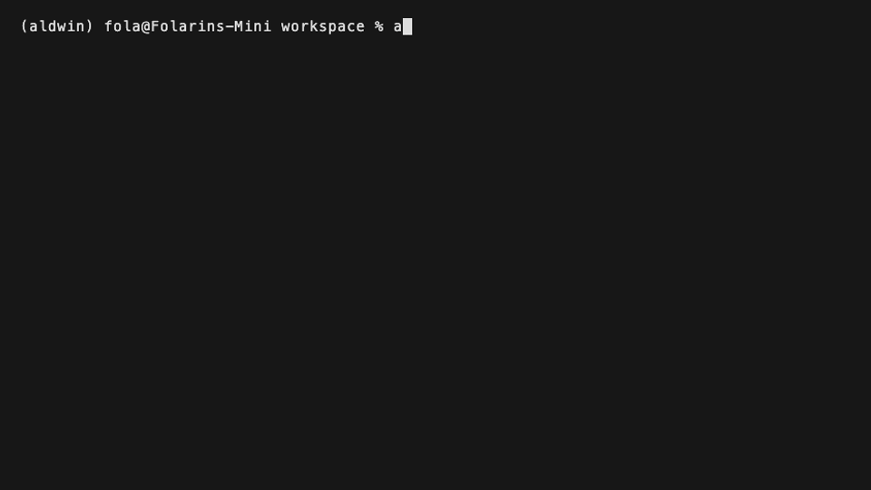

# Aldwin

An open-source personal assistant that works with your files and documents, knows good habits out of the box, and runs on your own computer, in your terminal, built on [Agentling](https://agentling.dev).



---

## Install

Install with [uv](https://docs.astral.sh/uv/) (Python 3.11+ on macOS or Linux):

```bash
uv tool install aldwin
```

If you don't have `uv` installed yet:

```bash
curl -LsSf https://astral.sh/uv/install.sh | sh
```

Or install with `pip`:

```bash
pip install aldwin
```

Then start Aldwin:

```bash
aldwin
```

Already on `0.0.3`? Upgrade in place and keep your conversation, memory, persona, and settings:

```bash
uv tool upgrade aldwin
```

### First run

The first time you run `aldwin`, it creates a private home folder at `~/.aldwin` and looks for a local model (Ollama or LM Studio). If one is running, you can chat with no account. Otherwise it offers a cloud provider (OpenAI, Anthropic, Gemini, OpenRouter, or DeepSeek) or shows how to install a local server. A Tavily key for web search is optional: Aldwin checks it with Tavily before saving it, and `Enter` skips it. You can connect any search provider later with `/search`.

If you already have an OpenAI key from an earlier install, Aldwin keeps it and does not force you to reconfigure.

After that, `aldwin` picks up your latest conversation where you left off. Type `/help` at the prompt to see what you can do. Switch models any time with `/model`.

---

## Run it fully local

No cloud account required when Ollama or LM Studio is already serving a model on your machine.

1. Install [Ollama](https://ollama.com) (or [LM Studio](https://lmstudio.ai)) and pull a tool-capable model, for example:

   ```bash
   ollama pull qwen3:8b
   ```

2. Install Aldwin (`uv tool install aldwin`) and run `aldwin`.

3. When Aldwin finds the local model, pick it and start chatting. Your prompts stay on loopback (`127.0.0.1` / `localhost`).

Built-in providers (bundled catalogue — no online lookup):

| Provider | Kind | Notes |
|---|---|---|
| Ollama | Local | Default `http://localhost:11434` |
| LM Studio | Local | Default `http://localhost:1234/v1` |
| OpenAI | Cloud | Needs an API key |
| Anthropic | Cloud | Needs an API key |
| Google Gemini | Cloud | Needs an API key |
| OpenRouter | Cloud | Needs an API key |
| DeepSeek | Cloud | Needs an API key |

**Other server:** use `/model` → Other server, or add an OpenAI-compatible endpoint under `providers:` in `~/.aldwin/config.yaml`:

```yaml
providers:
  my-local:
    title: My local server
    shape: openai_chat
    base_url: http://127.0.0.1:8080/v1
    local: true
```

Supported shapes are `openai_chat`, `anthropic`, and `ollama`. Non-loopback `http://` URLs require `local: true` (or use `https://`).

---

## What Aldwin can do

- **Files:** list, find, search, and read files in your workspace; edit or create them after showing you a diff.
- **Documents:** read PDF, Word, PowerPoint, Excel, CSV, and HTML files as markdown, and download files from the web.
- **Notes and memory:** remember facts you tell it, search past notes and conversations, and keep a profile you write yourself.
- **Persona:** change how Aldwin talks by editing `persona.md` or asking it to.
- **Web:** search the web and read pages.
- **Terminal:** run shell commands, always with your approval.
- **Planning:** keep a live checklist for longer jobs and do exact arithmetic and date maths.
- **Skills:** ten built-in skills, your own skills in `~/.aldwin/skills/`, and an `@` picker to choose one for a message.
- **Models:** switch between local and cloud providers with `/model`; see [Run it fully local](#run-it-fully-local).
- **Connectors:** connect Notion, Linear, GitHub, and more with `/connectors`; see the [Connectors](#connectors) section below.

See the [full tool list](https://github.com/lunarstack-co/aldwin/blob/main/docs/tools.md) and the [skills guide](https://github.com/lunarstack-co/aldwin/blob/main/docs/skills.md).

---

## Connectors

Aldwin can connect to your other apps as MCP servers. Add one with `/connectors`.

**Catalogue:** pick Notion, Linear, GitHub, Context7, and others from the built-in catalogue. Sign in through your browser and Aldwin stores the token in `~/.aldwin/credentials` (mode 0600).

**Any MCP server:** paste a URL to add any remote server that isn't in the catalogue.

**Local servers:** run a server from a command, for example:

```bash
npx -y @modelcontextprotocol/server-filesystem /path/to/folder
```

Local servers start only after you approve the command. They run with a minimal environment in your workspace folder. Local servers are not supported on Windows.

**Import:** `aldwin connectors import` brings in servers already configured in other agent apps.

**Ask Aldwin to connect:** type "connect me to Notion" and Aldwin proposes the connector for you to approve.

---

## Safety

Aldwin runs on your machine without a sandbox, so every tool call goes through a policy engine first:

- **Reading is free, changing asks.** Read-only tools run straight away. Edits show a diff and default to **No**. Shell commands and downloads ask every time.
- **Secrets are off limits.** SSH keys, cloud credentials, `.env` files and similar are blocked outright, whatever you or the model ask for.
- **Dangerous commands are refused.** `sudo`, `rm -rf /`, disk formatting and similar are refused before you're even asked.
- **Commands get a clean environment.** API keys, tokens, and passwords in your shell are never passed to commands Aldwin runs.
- **Everything read is untrusted.** Text from files, pages, and command output is treated as data, never as instructions.
- **Every decision is logged** to `~/.aldwin/logs/approvals.jsonl`, with secrets redacted.
- **Connector tools that only read run on Auto** based on the server's own hint. Turn the trust toggle off in `/connectors` and every tool from that server will ask first.
- **Anything that changes something asks you first.** Connector tools the server does not mark read-only always show an approval.
- **All connector output is treated as untrusted.** The same rule as for files and command output.
- **Tokens stay local.** Sign-in tokens are kept in `~/.aldwin/credentials` (mode 0600) and never pass through the model.
- **Local servers need approval and run in a clean environment.** If you edit the command by hand, Aldwin asks again before re-running it.
- **Known limits:** a server can mark a write tool read-only, and Aldwin will trust that hint. A local server runs with your user's rights; there is no sandbox.

Read the [safety model](https://github.com/lunarstack-co/aldwin/blob/main/docs/safety.md) for the full rules and known limits.

---

## Data and privacy

- **No telemetry.** Aldwin collects no analytics.
- **Sent to a cloud model provider:** when you use a cloud model, your prompts, recent conversation, your profile and recent notes, and anything Aldwin reads for the turn — including connector tool results — go to that provider.
- **Fully local:** when you use Ollama, LM Studio, or another loopback model, conversation data stays on your machine (except optional web tools, remote connectors, and the PyPI update check).
- **Stays local:** everything else in `~/.aldwin`, including your API keys, saved conversations, sign-in tokens, and logs. Connector tokens never go to the model.
- **Platforms:** macOS 13+ and Linux. Local MCP servers are not supported on Windows.

Read [data and privacy](https://github.com/lunarstack-co/aldwin/blob/main/docs/privacy.md) for the home folder layout and every network call Aldwin makes.

---

## Commands

| Command | What it does |
|---|---|
| `aldwin` | Open the chat and resume the latest conversation |
| `aldwin setup` | Set or update API keys and the default model |
| `/help` | Show slash commands and keyboard shortcuts inside the chat |
| `Esc` | Stop the current answer |

See all [commands, slash commands, and shortcuts](https://github.com/lunarstack-co/aldwin/blob/main/docs/commands.md), including how to uninstall.

---

## What's next

Aldwin runs inside your terminal process; it isn't always-on yet. Closing the terminal stops any active task, and your conversation resumes next time you run `aldwin`. Windows is not yet supported.

Web search works with self-hosted SearXNG or one hosted search key. Type `/search`, pick a provider with the arrow keys, and paste its key: Aldwin checks the key with the provider before saving it, and tells you why if it doesn't work. The same screen switches provider, updates a key, or disconnects one. Step-by-step guides for every provider are at [askaldwin.com/docs/search](https://askaldwin.com/docs/search/overview); for SearXNG see also [Set up SearXNG](docs/searxng.md).

| Provider | Cost | Key check |
|---|---|---|
| SearXNG | free, runs on your computer | found automatically on `:8080`, or enter its address |
| Tavily | free monthly credits, then paid | free; can take up to 20 seconds |
| Brave | paid plan | uses one Brave query |
| Exa | paid | free |
| Perplexity | paid | free |
| Parallel | paid | free |
| Firecrawl | paid plan with credits | free |

Keys are saved in `~/.aldwin/secrets.yaml` (mode `0600`). You can also set them in the environment (`TAVILY_API_KEY`, `BRAVE_API_KEY` or `BRAVE_SEARCH_API_KEY`, `EXA_API_KEY`, `PERPLEXITY_API_KEY`, `PARALLEL_API_KEY`, `FIRECRAWL_API_KEY`, `SEARXNG_URL`); an environment variable wins over a saved key. With `search.provider: auto` (the default), Aldwin uses the first connected provider in the order above, so a Tavily key wins over SearXNG.

---

## Contributing

Contributions are welcome. Read the [contributing guide](https://github.com/lunarstack-co/aldwin/blob/main/CONTRIBUTING.md) to get set up, and see the [docs index](https://github.com/lunarstack-co/aldwin/blob/main/docs/README.md) for the protocol, test, and release docs.

Have a question or an idea? Start a [discussion](https://github.com/lunarstack-co/aldwin/discussions). Found a bug? Open an [issue](https://github.com/lunarstack-co/aldwin/issues).

---

## Licence

Apache-2.0. See [`LICENSE`](https://github.com/lunarstack-co/aldwin/blob/main/LICENSE) and [`NOTICE`](https://github.com/lunarstack-co/aldwin/blob/main/NOTICE).
